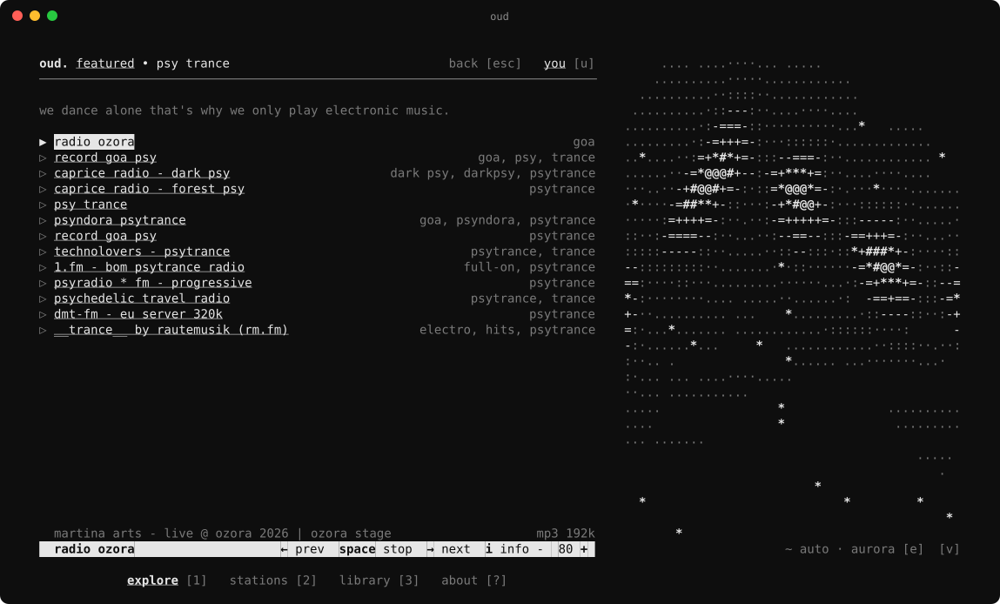

# oud

oud. your signal, in the terminal.



A full-screen internet radio player for [oud.so](https://oud.so): thousands of
live stations from every country, by genre and by mood. It plays audio
itself: no mpv, no ffmpeg, nothing else to install.

## Install

```sh
brew install oud-so/tap/oud
oud
```

macOS on Apple silicon or Intel. Updates come with `brew upgrade oud`.

## Build from source

```sh
cargo run --release
cargo install --path .   # the oud command, from this checkout
```

`OUD_API_URL` (or `--api`) points it at another API, e.g. a local one.

## Updates

Once a day, in the background, oud asks the API for the newest release
(`/v1/terminal/version`, which reads the tap's GitHub releases). When one is
out it says so on the bottom line and on the about screen, with
`brew upgrade oud` when it was installed by Homebrew. Nothing is downloaded
or replaced by oud itself. If the API sets a minimum version this copy is
below, the line says it is too old to keep working.

`oud --version` prints the version; `OUD_NO_UPDATE_CHECK=1` turns the asking
off.

## Your account

Listening needs no account. Bookmarks and lists are the account's, the same
ones as on oud.so and the Mac app: press `u` (or click "you", top right) and
sign in one of two ways.

- **in the browser**: the terminal shows a code like `ABCD-EFGH` and opens
  `oud.so/device`; sign in there with Google or email and approve the code.
  Works over SSH too: open the address on any device.
- **by email**: type your address, then the six-digit code that arrives.

The session is kept in `session` beside `state.json` (readable by you only)
and ends with "sign out" (`o` on the you screen), on the server as well.

## Keys

| key | does |
|---|---|
| `↑ ↓` | move |
| `enter` | play / open |
| `space` | stop / resume |
| `← →` | previous / next station in the list you played from |
| `- +` | volume |
| `s` | bookmark / remove (signed in) |
| `i` | station details above the player: place, tags, format, homepage (`w`), recent titles, map |
| `/` | search stations |
| `g` `c` | pick a genre / country |
| `f` `r` | explore: featured ⇄ small signals, another eight |
| `t` | library: bookmarks ⇄ lists |
| `esc` | back / clear filters |
| `e` `E` | next / previous visual (auto, then each pattern) |
| `v` | show / hide the visual |
| `tab` `1`–`4` | explore · stations · library · about (the bar is clickable too) |
| `u` | you: sign in, see who is signed in, sign out; `u` again goes back |
| `?` | about: keys, and links to oud.so (`o`) and @forwardset (`x`); `?` again goes back |
| `q` | quit |

## How it works

```
oud API ──► stream list (best first, failover in order)
              │
   http/icy ──┤── IcyReader: strips in-band metadata, reports track titles
        hls ──┘── HlsReader: follows the live playlist, packed audio or MPEG-TS
              │
         symphonia (mp3 · aac-lc · vorbis · flac) ──► stereo f32
              │
         Resampler (cubic Hermite) ──► device rate
              │
         lock-free ring ──► cpal output callback (volume, preroll, meter tap)
```

- `src/api.rs`: oud.so API client.
- `src/audio/`: the engine. `mod.rs` runs a tune session per station with
  failover and reconnects; `output.rs` owns the sound card for the whole run.
- `src/ui/`: ratatui interface styled after the site: lowercase monospace,
  underlined links, dim secondary text, one inverted player bar.
- `src/visual.rs`: the abstract ASCII visual beside the column on wide
  terminals. Twelve fields (plasma, tunnel, ripples, spiral, weave, rain,
  aurora, kaleido, orbs, dunes, warp, lattice); in auto they crossfade
  into each other, or one can be pinned with `e`; bass swells them and sends rings out, mids speed them up,
  treble throws sparks. Each new station reshuffles the shapes.
- `src/map.rs`: the details map, in braille dots. Country boundaries come
  from the `country-boundaries` crate; the data is derived from
  OpenStreetMap (ODbL, © OpenStreetMap contributors), credited under the
  map and on the about screen.
- `src/store.rs`: volume, the visual and the last station, in the platform
  config directory (`~/Library/Application Support/so.oud.oud/state.json` on
  macOS), and the session token in its own file there.

Not yet: HE-AAC (aac+) plays only its base layer, and Opus streams are
skipped in favour of another stream for the station.
